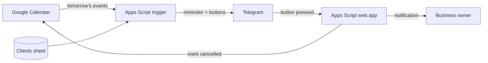

# Appointment Reminders with Confirmation Buttons

A Telegram reminder system for small service businesses (beauty studios, tutors, clinics).
Clients get a reminder the day before their appointment and confirm or cancel with one tap; the owner is notified instantly.

## Features

- **Client subscription:** a client opens the bot and shares their phone number with one button; name, phone and chat ID are saved to a `Clients` sheet
- **Daily reminders:** a time-driven trigger checks tomorrow's Google Calendar events and finds the client by the phone number in the event title or description
- **Confirm / cancel buttons:** "✅ I'll come" / "❌ Can't come" (inline keyboard)
- **Owner notifications:** new subscriptions, confirmations and cancellations; cancelled events are marked with ❌ in the calendar
- **Daily report:** how many reminders were sent and which clients must be reminded manually (not subscribed or no phone in the event)
- **Logging** of all updates and API errors in a `Log` sheet

## How it works

## Tech stack

Google Apps Script (web app + time-driven trigger) · Telegram Bot API (webhooks, inline and contact keyboards) · Google Calendar · Google Sheets

## Setup

1. Create a bot with @BotFather; the owner presses **Start** in the bot.
2. Create a Google Sheet → **Extensions → Apps Script** → paste `Code.gs`.
3. **Script Properties:** `TELEGRAM_TOKEN`, `OWNER_CHAT_ID`, optional `CALENDAR_ID` and `STUDIO_NAME`, and `WEBAPP_URL` after deployment.
4. Set the project time zone, run `sendReminders` once to grant permissions.
5. **Deploy → Web app** (execute as Me, access Anyone), save the `/exec` URL to `WEBAPP_URL`, run `setWebhook`.
6. **Triggers → Add trigger:** `sendReminders`, time-driven, daily (e.g. 18:00–19:00).

## Test scenarios

| Scenario | Expected result |
|---|---|
| Client shares their own contact | Saved to `Clients`, owner notified |
| Client shares someone else's contact | Rejected, asked to share own number |
| Event with a subscribed client's phone | Reminder with buttons is sent |
| Event without a phone / unsubscribed client | Listed in the owner's report as "remind manually" |
| Phone in different formats (`067…`, `+38067…`, with spaces) | Matched by the last 9 digits |
| Client presses "Can't come" | Buttons removed, owner notified, event marked ❌ |
| All-day events | Ignored |

Tested end-to-end with real users (family members acting as clients).

## Screenshots

Add to `docs/` (blur names and phone numbers):

- `docs/reminder.png` — reminder with buttons on the client's phone
- `docs/owner-notifications.png` — owner's notifications and daily report
