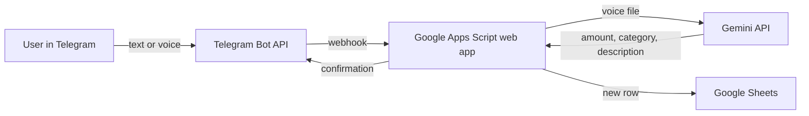

# Telegram Expense Tracker (text + voice)

A personal Telegram bot that records expenses into Google Sheets.
Send a text like `bread 30`, or just record a voice message, and the expense is saved with date, amount, category and description.

## Features

- **Text input:** `coffee 85`, `groceries 1250 supermarket`, the first word is matched to a category
- **Voice input:** a voice message is transcribed and parsed by **Gemini AI**, which extracts the amount, category and description
- **Custom categories:** stored in a `Categories` sheet, with optional keywords per category
- **Monthly report:** `/month` returns spending by category for the current month
- **Private bot:** responds only to the owner's Telegram chat ID
- **Logging:** every incoming update and every error is written to a `Log` sheet for debugging

## How it works

## Tech stack

Google Apps Script · Telegram Bot API (webhooks) · Gemini API · Google Sheets

## Setup

1. Create a bot with [@BotFather](https://t.me/BotFather) and copy the token.
2. Create a Google Sheet; open **Extensions → Apps Script** and paste `Code.gs`.
3. In **Project Settings → Script Properties** add:
   - `TELEGRAM_TOKEN` — bot token
   - `ALLOWED_CHAT_ID` — your Telegram chat ID
   - `GEMINI_API_KEY` — key from Google AI Studio
   - `GEMINI_MODEL` — optional, defaults to the model in the code
4. **Deploy → New deployment → Web app**: execute as *Me*, access *Anyone*. Copy the `/exec` URL.
5. Connect the bot: open
   `https://api.telegram.org/bot<TOKEN>/setWebhook?url=<EXEC_URL>&drop_pending_updates=true`
6. Send the bot `bread 30` and check the sheet.

## Testing and issues found

Tested with valid and invalid input: messages without an amount, decimal amounts, unknown categories, voice messages without a sum, messages from other users.

Issues found and fixed during development:

| Issue | Root cause | Fix |
|---|---|---|
| Bot did not answer, nothing in execution log | Webhook URL pointed to an editor link / old deployment | Verified with `getWebhookInfo`, re-set webhook to the correct `/exec` URL |
| Bot ignored the owner | Chat ID saved with an extra `#` from the Telegram Web URL | Fixed config; added logging of incoming updates |
| The same message processed again and again, later messages stuck | Apps Script returned **HTTP 302**; Telegram treated it as a failure and kept retrying the same update | Return `HtmlService` output, add duplicate protection by `update_id`, clear queue with `drop_pending_updates` |
| Voice messages failed | Gemini model deprecated (**404**), then temporary overload (**503**) | Model name moved to config; automatic retries with backoff on 503 |
| "Unknown error" when running the script | Several Google accounts signed in at once | Run and deploy from a single-account session |

## Screenshots

Add your screenshots to `docs/` (blur personal data):

- `docs/bot-chat.png` — conversation with the bot
- `docs/sheet.png` — expenses in Google Sheets
